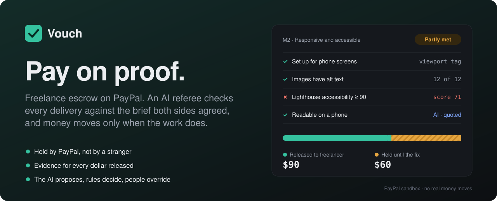
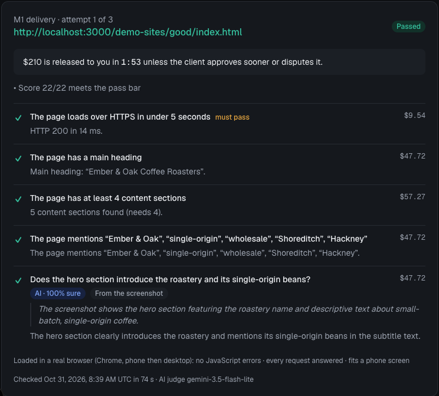
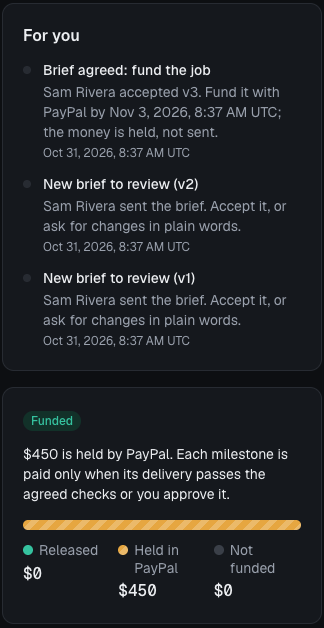
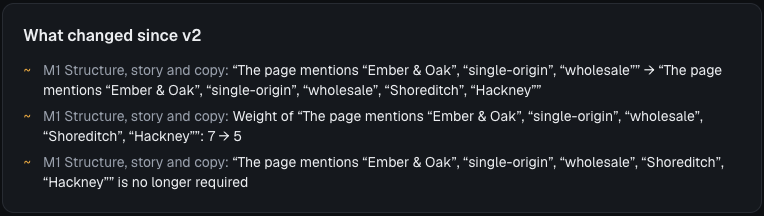
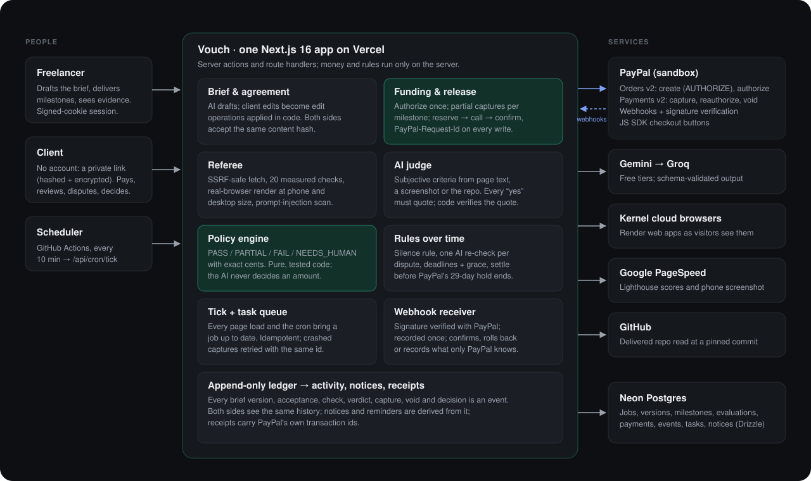

<!-- Before submitting: replace DEMO_URL and VIDEO_URL below with the Render URL and the YouTube link. -->
<div align="center">



<br>

[](https://github.com/nooorf/vouch/actions/workflows/ci.yml)


<br>


**[▶ 3-minute demo](VIDEO_URL) · [Try it live](DEMO_URL) · [How it works](#how-it-works) · [Results](#can-you-trust-the-referee) · [Where the money goes](#where-the-money-goes) · [Architecture](#architecture)**

</div>

## Freelance work, paid on proof instead of trust

**Vouch is pay-on-proof for freelance work, refereed by an AI that has to show its evidence.** The client's payment is held by PayPal. Every delivery is checked against the brief both sides agreed to. Money is released milestone by milestone: in full when the work passes, in part when it partly does, and not at all when it doesn't. Both sides see exactly why.

**Who it's for.** Freelancers and clients who work directly with each other: agency work, referrals, clients met on LinkedIn, Discord or email, often across borders. Today they choose between trusting a stranger and moving the deal onto a marketplace that takes a cut and keeps the relationship. Vouch gives a direct deal the protection of a held payment, without the marketplace.

<table>
<tr>
<td width="50%" valign="top">

### For the client
- **Pay only for work that meets the brief.** The money stays in PayPal until a delivery passes its checks or you approve it.
- **Evidence, not assurances.** Every result shows what was measured and quotes what was judged.
- **Never stuck.** Approve, dispute once for an AI re-check, or hold for a fix. If a deadline is missed, cancel and get the unused money back.

</td>
<td width="50%" valign="top">

### For the freelancer
- **Know the money exists before you start.** The full amount is authorized in PayPal on day one.
- **Get paid even if the client goes quiet.** When the review window closes, the verdict executes on its own.
- **A fix list, not "I'm not happy".** Partial work earns partial pay, and you see exactly what to fix for the rest.

</td>
</tr>
</table>

> **The AI proposes, the rules decide, a person can always override.** The AI drafts briefs and judges what can't be measured. Plain, tested code decides every amount, and it can never release more than the client authorized.

## Try it

Open **[the live demo](DEMO_URL)** and click **Try the demo**. No sign-up: you get a private workspace on the PayPal sandbox and play both sides, switching between the freelancer's and the client's view in one click.

- **Paying:** the client page shows a sandbox buyer login. No real money moves.
- **Delivering:** one-click demo deliveries: a good site, a flawed one, its fixed version, and a hostile page that tries to talk the AI into paying.
- **Watching time pass:** demo jobs use a 2-minute review window, and a "skip to the deadline" button shows what happens when a freelancer misses one.

To run it yourself, see [Run it locally](#run-it-locally).

## How it works

<table>
<tr><td width="40" align="center"><b>1</b></td><td><b>Agree on a brief.</b> The freelancer describes the job in plain words. The AI drafts milestones with amounts and checkable criteria: measured rules ("loads in under 5 seconds", "Lighthouse accessibility ≥ 90", "has a form with name, email, message") and judged questions ("does the copy read as written for a coffee roastery?"). The client accepts, or asks for changes in plain words, and the AI turns them into exact edits. Money can only be held once both sides accept the same version, fingerprinted by a content hash.</td></tr>
<tr><td align="center"><b>2</b></td><td><b>Fund it in PayPal.</b> The client pays through PayPal's checkout. The total is <i>authorized</i>, not captured: PayPal holds it, and nothing reaches the freelancer yet.</td></tr>
<tr><td align="center"><b>3</b></td><td><b>Deliver and get checked.</b> The freelancer submits a live link (and optionally a GitHub repo). The referee loads it in a real browser at phone and desktop size, runs the measured checks, and asks the AI only what rules can't measure. Every "yes" from the AI must quote the page or cite file and lines, and code verifies the quote exists.</td></tr>
<tr><td align="center"><b>4</b></td><td><b>Release by the rules.</b> The policy engine turns the results into PASS, PARTIAL, FAIL or NEEDS_HUMAN with exact amounts. The client has a review window to approve or dispute; if they stay silent, the verdict executes through a PayPal capture. When every milestone is settled, the unused hold is voided and both sides get a receipt with PayPal's transaction ids.</td></tr>
</table>

<table>
<tr>
<td width="62%" valign="top"></td>
<td width="38%" valign="top"></td>
</tr>
<tr>
<td valign="top"><sub><b>Every verdict shows its evidence.</b> Each check states what it measured and what share of the payment rides on it. The AI's answer quotes what it saw. Both sides see the same card and the countdown to release.</sub></td>
<td valign="top"><sub><b>The client sees what's held and what's next.</b> Money held by PayPal, not yet released, and notices for anything that needs them.</sub></td>
</tr>
<tr>
<td colspan="2"></td>
</tr>
<tr>
<td colspan="2"><sub><b>Negotiation without surprises.</b> When the client asks for a change in plain words, the AI proposes edits, and code computes this list from the real edits, including anything the client didn't ask for, before anyone accepts.</sub></td>
</tr>
</table>

### Fair to both sides, on every edge case

| What happens if… | Vouch's rule |
|---|---|
| The client never responds | When the review window closes, the verdict executes: passing work is paid. |
| The work is only partly done | The share backed by passing criteria is released; the rest is held with a fix list. The freelancer can resubmit (twice by default). |
| The client disagrees with the referee | They name the criteria they dispute. Nothing is released while the AI checks once more with their objection; then the client decides. |
| The AI can't tell | NEEDS_HUMAN: nothing is guessed. A person decides, and silence releases only the share backed by measured checks. |
| A delivery tries to manipulate the AI | Instructions aimed at an AI grader, including hidden text and code comments, are detected in code and send the delivery to a person. |
| The freelancer disappears | Before a deadline, a job ends only by agreement. After a missed deadline and a 24-hour grace period, the client can cancel and the unused hold is voided. |
| The job runs long | PayPal holds a payment for 29 days. Vouch reauthorizes after day 3, gives notice around day 25, and settles everything by the agreed rules a day before the hold ends. |

## Can you trust the referee?

A referee that decides when money moves is only as good as its record on work it has never seen. We ran it, exactly as production runs it, on public websites and open-source repositories with realistic briefs, labelled by a person **before** the referee saw them.

| Benchmark | Deliveries | Verdicts right | Criteria right | Money released that shouldn't have been |
|---|---:|---:|---:|---:|
| **Held-out websites** | 18 | **18/18** | **85/85** | **0** |
| **Held-out repositories** (code questions) | 7 | **7/7** | **32/32** | **0** |
| Development set | 12 | 12/12 | 59/59 | 0 |

The held-out sets include client-rendered React and Svelte apps, uncustomized templates, wrong deliveries, broken pages, dead links, an 8-second page, a 1996 site submitted as "mobile-friendly", and two shops that look real but say on the page that nothing is for sale. The first held-out run scored 16/18 with one wrong release; the fixes were general rules, never site-specific, and twice the referee turned out to be right where our own labels were wrong. The last column matters most: a referee that wrongly withholds can be corrected by the client, one that wrongly releases can't.

Full method, misses and known limits: **[referee evaluation report](docs/referee-evaluation.md)**.

## Built on PayPal

Every dollar moves through PayPal's APIs, server-side, with amounts read from the database, never from the browser.

| PayPal API | How Vouch uses it |
|---|---|
| **Orders v2**: create with `intent: AUTHORIZE`, authorize, get | One order per job holds the agreed total. After authorizing, the held amount must equal the agreed total to the cent, or the hold is voided at once. A checkout interrupted after approval is finished on the next page load. |
| **Payments v2**: capture (`final_capture: false`) | Many partial captures against one authorization, one per milestone release. Each is reserved in the database before PayPal is called, with a deterministic `PayPal-Request-Id`, so a retry or two simultaneous clicks can never pay twice. |
| **Payments v2**: reauthorize | Once, after the 3-day honor period, so later captures stay guaranteed. (Sandbox testing showed PayPal allows exactly one reauthorization; we designed around that.) |
| **Payments v2**: void | Returns the unused hold when a job completes, is cancelled, or runs into the 29-day limit. |
| **Webhooks**: `verify-webhook-signature` | Approved checkouts, authorizations, captures (completed or denied), voids and refunds. Each event is verified with PayPal, recorded once, and reconciled with the same idempotent code the pages use. |
| **JavaScript SDK** buttons | The client's checkout, with the order created and authorized on the server. |

### Where the money goes

**In this build, Vouch's own PayPal merchant account receives the captures, and each freelancer's earnings are tracked in the ledger.** The ideal is that PayPal pays the freelancer directly and the platform never holds funds. We tested that first, and it's the production path.

| | Freelancer as payee (tested in sandbox) | Platform as payee (this build) |
|---|---|---|
| Authorize the full amount | ✓ | ✓ |
| Partial captures, one per milestone | ✓ Money lands in the freelancer's PayPal account | ✓ |
| Void the unused hold (cancel, completion, day 29) | ✗ `403 PERMISSION_DENIED` | ✓ |
| Act on the freelancer's behalf (`PayPal-Auth-Assertion`) | ✗ `400`: needs partner onboarding | Not needed |

Paying the freelancer directly works for every capture, but returning unused money to the client requires acting on the freelancer's behalf. That needs PayPal partner onboarding, which a hackathon app can't get. Without the void, a client could never get unused money back, so this build has the platform hold the funds and keeps every flow working.

**In production:** freelancers onboard as merchants through **PayPal Multiparty** (Partner Referrals), and Vouch captures and voids on their behalf with an auth assertion. Money goes straight from the client's hold to the freelancer, and Vouch never holds it. Nothing else changes: the referee, the policy engine and the ledger are independent of who the payee is. You can reproduce the direct-capture test with `npm run smoke -- --payee`.

## Built with APIMatic

The PayPal integration was written with **APIMatic's context plugin for the PayPal Server SDK** (`@paypal/paypal-server-sdk`, pinned at 2.5.0), used as agent skills while coding. It caught problems that the SDK's types don't show:

- **No timeout by default.** The generated client waits forever (`timeout: 0`). We set 15 seconds.
- **No retries by default.** Retries are off until both `maxNumberOfRetries` and `maximumRetryWaitTime` are set. We enabled them, which is safe because every write carries a request id.
- **Logging leaks.** Supplying any logging config prints every request and response, so we removed it and log failures ourselves.
- **Error bodies.** A bare `ApiError` leaves `result` undefined; the details are in `body` with PayPal's own field names (`details[0].issue`, `debug_id`). Our error helper reads them, which is how sandbox testing surfaced `REAUTHORIZATION_TOO_SOON` and shaped the money model.
- **What the SDK doesn't cover.** There is no webhook operation, so signature verification calls PayPal's REST endpoint with a token from the SDK's own auth manager.

## Architecture



## Engineering highlights

<details>
<summary><b>Money that can't move twice, or too far</b>: reserve-then-capture, request ids, crash recovery, row locks</summary>
<br>

- **Reserve, call, confirm.** A capture is first written as a pending payment, counted against the authorization under a row lock, then sent to PayPal with a deterministic `PayPal-Request-Id`, then confirmed or rolled back. A crashed capture is retried with the same id, and PayPal returns the original result instead of charging again.
- **Hard ceilings in code.** Nothing is captured above what the client authorized, or above a milestone's amount. A failed required check releases nothing, whatever the AI says.
- **One lock decides races.** Deliveries, cancellations and releases take the same job row lock, so a delivery and a cancel can't both win, and two simultaneous approvals can't both pay.
- **The state survives PayPal being down.** Cancelling marks the job first and voids second; the tick retries a failed void. Every page load and a scheduled job bring each job up to date ("tick on read"), so nothing depends on a webhook arriving.
- **Money in integer cents**, everywhere except the PayPal wire format.

</details>

<details>
<summary><b>An AI referee that has to prove itself</b>: measured first, quotes verified, injection detected, held-out benchmark</summary>
<br>

- **Measured before judged.** 20 deterministic checks in four groups: page structure and content, web apps in a real browser (JavaScript errors, failed API calls, phone layout), Google Lighthouse, and GitHub. Each returns plain-English evidence.
- **Web apps judged as a visitor sees them.** Every delivery is rendered in a real browser (Kernel cloud browsers when deployed, local Chrome in development), so client-rendered React and Vue apps aren't judged on an empty HTML shell.
- **Every "yes" is verified.** Page answers must quote the visible text, code answers must cite file and lines from the repository at a pinned commit, and code checks that the quote really exists. A made-up quote, low confidence, or an unmeasurable check sends the decision to a person.
- **Prompt injection handled in code.** A detector scans comments, hidden elements, attributes and visible text for instructions aimed at an AI grader. Hidden text is removed before the AI reads the page, and any hit sends the delivery to a person.
- **Edits, not rewrites.** When a client asks for changes, the AI returns edit operations; code applies them, rejects what breaks the rules, and computes the "what changed" list from the real edits.
- **Two free AI providers.** Gemini first, Groq as the fallback when Gemini is out of quota or busy. Every answer is validated against a schema, and responses are cached to stay within free limits.

</details>

<details>
<summary><b>Security</b>: SSRF-safe fetching, private client links, verified webhooks, server-only money</summary>
<br>

- **Untrusted links fetched safely.** The referee resolves DNS itself, refuses private, loopback, link-local, metadata and reserved ranges (including IPv4 hidden in IPv6), connects to exactly the address it checked, re-checks every redirect, and caps time and size (counted after decompression). Tests prove a redirect to `169.254.169.254` is refused.
- **Client links that a database leak can't expose.** Jobs are looked up by a SHA-256 hash of the link token; the token itself is stored AES-256-GCM encrypted so the freelancer can copy it again.
- **Webhooks verified with PayPal**, using the exact bytes PayPal sent (re-serialized JSON can fail genuine events).
- **Validated at every boundary.** Zod schemas for environment variables, form input, briefs and AI output; amounts always come from the database.

</details>

<details>
<summary><b>Testing and quality</b>: 208 unit tests, AI evals, real-PayPal walk-through, held-out benchmark, CI</summary>
<br>

- **208 unit tests** (Vitest) for the policy engine, money math, captures and limits, cancellation and deadline rules, the 29-day hold, notices, webhook parsing, the SSRF guard, the injection detector, quote verification and the AI layer.
- **AI evals** (`npm run eval`) run the real models on fixed cases: brief drafting, change proposals, the page judge, the code judge, and the referee benchmark. They caught real problems before users did, such as the AI weighting "the page loads" at a quarter of a milestone's pay.
- **A browser walk-through** (`npm run e2e`) plays the whole demo against real PayPal sandbox payments: brief, negotiation, funding, delivery, evaluation, silence rule, dispute, partial release, completion and receipt.
- **The referee benchmark** above, with frozen, fingerprinted labels.
- **CI on every push:** typecheck, lint, unit tests and a production build.

</details>

## Run it locally

**Prerequisites:** Node 24, a [Neon](https://neon.tech) Postgres database, a [PayPal developer](https://developer.paypal.com) sandbox app, and a free [Gemini API key](https://aistudio.google.com). Everything else is optional and switches on when its key is set (`npm run env:check` shows what's on).

```bash
npm install
cp .env.example .env.local      # fill in the values; each one is explained in the file
npm run db:migrate              # create the tables
npm run demo:warm               # pre-compute the demo's AI draft (instant demo)
npm run dev                     # http://localhost:3000
```

```bash
npm test                        # unit tests
npm run e2e                     # browser walk-through with real sandbox payments
npm run eval                    # AI evals (add --fresh to skip the cache)
npm run eval -- referee         # the referee benchmark
npm run referee -- <url>        # run the measured checks on any URL
npm run smoke                   # PayPal sandbox smoke test
```

<details>
<summary><b>Deploying on Render</b></summary>
<br>

1. Create a **Web Service** from this repository: build `npm ci && npm run build`, start `npm start`, and set `NODE_VERSION=24`.
2. Add the variables from `.env.local`, with `APP_URL` set to the Render URL. Web-app rendering in production needs `KERNEL_API_KEY`.
3. In the PayPal developer dashboard, add a webhook for `https://<app>/api/paypal/webhook` with the six events listed in `src/lib/paypal/webhook-event.ts`, and set `PAYPAL_WEBHOOK_ID`.
4. Add `APP_URL` and `CRON_SECRET` as GitHub repository secrets. The **Tick** workflow then brings idle jobs up to date every 10 minutes.

</details>

<details>
<summary><b>Project structure</b></summary>
<br>

```
src/
  app/              pages, server actions, /api/paypal/webhook, /api/cron/tick
  components/       evaluation card, money bar, receipt, activity, notices
  db/               Drizzle schema (jobs, brief versions, milestones, evaluations,
                    payments, events, tasks, notifications)
  lib/
    brief/          brief schema, check library, drafting, revision, content hash
    policy/         the policy engine: verdicts, partial releases, capture guards
    referee/        SSRF-safe fetch, checks, browser render, Lighthouse, GitHub snapshot,
                    page judge, code judge, injection detector
    jobs/           agreement, delivery, settlement, cancellation, 29-day hold, tick, task queue
    paypal/         SDK client, funding, webhooks
    notify/         notices and reminders derived from the ledger
    llm/            Gemini and Groq providers with schema validation
evals/              AI evals and the referee benchmark (labels frozen and fingerprinted)
scripts/            e2e walk-through, smoke test, referee CLI, demo cache, cleanup
public/demo-sites/  the four demo deliveries (good, flawed, fixed, hostile)
docs/               referee evaluation report, README assets
drizzle/            database migrations
```

</details>

## Tech stack

Next.js 16 (App Router, server actions) · React 19 · TypeScript · Tailwind CSS 4 · PayPal Server SDK · PayPal JS SDK · Drizzle ORM · Neon Postgres · Zod · Google Gemini · Groq · Kernel · Puppeteer · Google PageSpeed Insights · Cheerio · Vitest · GitHub Actions · Render

## License

[MIT](LICENSE). Built for the PayPal AI Hackathon 2026. Runs on the PayPal sandbox; no real money moves.
